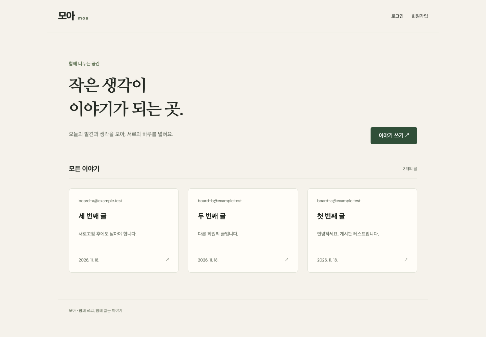
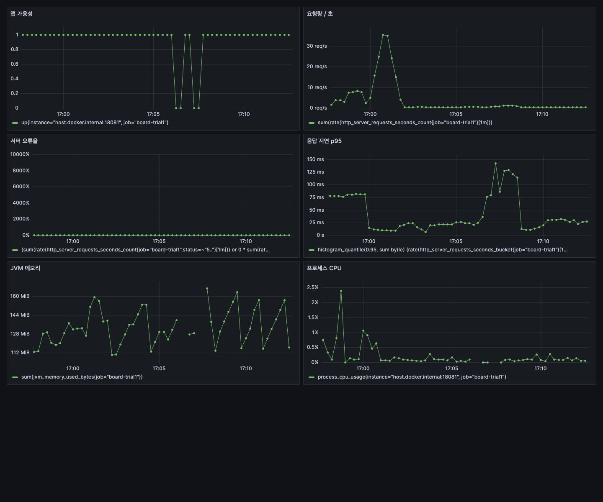

# 모아 — 회원 게시판 실험

Spring Boot·React·PostgreSQL로 만든 공개 게시판입니다. 이메일 가입·로그인·로그아웃, 공개 글 조회, 회원 작성, 작성자 수정·삭제를 지원합니다. 이 저장소는 SECOND BRAIN OS 풀스택 개발·협업 워크플로우 테스트1의 산출물입니다.



## 확인한 결과

- AUTH 8개·BOARD 11개·INT 5개 기능 시나리오와 하위 입력을 실제 브라우저·API·PostgreSQL로 검증했습니다.
- 서버 단위·통합 검사, Java 포맷, JavaScript 린트·포맷, 프론트엔드 빌드를 실행했습니다.
- k6 5 VU·60초에서 2,340개 요청, 오류율 0%, p95 11.84ms였습니다.
- 앱 중단 탐지 2.36초, 복구 2.24초, 기존 글 3개 유지와 복구 후 인증·쓰기를 확인했습니다.

전체 실험은 완전 성공으로 판정하지 않습니다. 작업 중 에이전트의 비밀값 취급 위반 1건이 발생했고 사용자 배포·클라우드 검증·독립 리뷰·최종 수용이 남아 있습니다. 기능 결과와 과정·운영 한계는 [지표 보고서](docs/metrics.md), [품질 검토](docs/review.md)에 있습니다.

## 구조

```text
web/src       React 화면과 API 호출
backend/src   HTTP 컨트롤러 → 서비스 → JDBC 저장소
PostgreSQL    회원·비밀번호 해시·게시글의 영속 저장
monitoring    Prometheus 수집과 Grafana 대시보드
 tests        Playwright UI·API·저장 상태 검사
scripts       시험 앱 수명 관리·초기화·부하·장애·관측
 evidence     실행 결과·실제 화면·원문 보존 사본
```

서버가 작성자 ID를 결정합니다. 비밀번호는 BCrypt, 인증은 30분 서버 세션과 HttpOnly 쿠키입니다. 모든 변경 요청은 CSRF 토큰을 요구합니다. 로컬 UI 프록시와 배포용 Vercel rewrite로 브라우저 요청을 동일 출처에 둡니다. 앱 재기동 후 재로그인이 필요하며 회원과 게시글은 유지됩니다.

## 로컬 실행

Java 21, Node 22, Docker가 필요합니다. 현재 검증 버전은 Gradle 9.2.1, Spring Boot 4.1.2입니다. npm 버전은 package-lock.json에 고정했습니다.

```sh
npm ci
npx playwright install chromium
docker volume create board-trial1-db
docker compose up -d postgres
./gradlew :backend:bootJar
node scripts/app.mjs start
npm run dev
```

이미 이 실험의 `board-trial1-db` 컨테이너가 있으면 `docker start board-trial1-db`로 시작합니다. 현재 세션에서는 앱·UI·DB·모니터링이 실행 중입니다.

- 화면은 http://127.0.0.1:15173 입니다.
- 서버는 http://127.0.0.1:18081 입니다.
- Swagger UI는 http://127.0.0.1:18081/swagger-ui.html 입니다.
- OpenAPI JSON은 http://127.0.0.1:18081/v3/api-docs 입니다.

합성 데이터가 필요한 경우 앱을 실행한 상태에서 다음을 사용합니다. 초기화는 전용 로컬 board_trial1 DB의 회원·글과 현재 앱 세션을 비웁니다.

```sh
node scripts/reset.mjs --trial1
node scripts/seed.mjs
```

검사용 공개 계정 A는 `board-a@example.test`, B는 `board-b@example.test`이며 합성 비밀번호는 tests/helpers.js에 있습니다. 실제 계정에 재사용하지 않습니다. 원문 데이터와 선택 정책은 [실험 계약](docs/experiment.md)에 있습니다.

## 검사 재현

앱·DB·UI를 실행한 상태에서 실행합니다. E2E는 각 시나리오 전에 전용 DB와 세션을 초기화하며 한 worker로 동작합니다.

```sh
./gradlew :backend:check
npm run lint
npm run format:check
npm run build
npm run test:e2e
```

명세 대응은 tests/auth.spec.js의 AUTH-01~08, tests/board.spec.js의 BOARD-01~11, tests/integration.spec.js의 INT-01~05입니다. 각 검사는 기대 HTTP 응답과 DB 전후 상태를 확인하며 인증 자격은 메모리에서만 사용합니다. 실행 증거는 evidence/playwright.json, 이전 실패는 evidence/playwright-first.json에 남깁니다. 단위·통합 보고서는 backend/build/reports/tests/test/index.html입니다.

운영 시험은 승인된 로컬 범위에서만 실행합니다. 먼저 관측 상태를 확인하고 새 부하 실행 때는 합성 계정을 초기화합니다.

```sh
docker compose up -d prometheus grafana
node scripts/reset.mjs --trial1
node scripts/seed.mjs
python3 scripts/load-watchdog.py
node scripts/fault.mjs
node scripts/recovery-check.mjs
node scripts/observe.mjs
```

부하 수용 기준은 오류율 1% 미만·p95 500ms 미만입니다. 1초 구간의 오류율 5% 또는 p95 2초 초과가 10회 연속 발생하면 중단합니다. 장애 시험은 관리 중인 앱 PID만 중단하고 최대 30초 기동 대기 후 실패를 보고합니다. DB를 재기동하거나 초기화하지 않습니다. 중간 실패 뒤에는 `.runtime/app.pid`와 로그·포트 상태를 확인한 다음 재개합니다.



## API 연결표

| 사용자 행동 | 요청 | 성공 | 주요 오류 |
| --- | --- | --- | --- |
| CSRF 준비 | GET /api/auth/csrf | 200 token, headerName | 세션 생성 |
| 가입 | POST /api/auth/signup | 201 id, email | 400 입력, 409 중복 |
| 로그인 | POST /api/auth/login | 200 id, email | 400 입력, 401 인증 |
| 현재 사용자 | GET /api/auth/me | 200 id, email | 401 |
| 로그아웃 | POST /api/auth/logout | 204 | 403 CSRF |
| 공개 목록·상세 | GET /api/posts, /api/posts/{id} | 200 | 404 |
| 작성 | POST /api/posts | 201 | 400, 401, 403 |
| 수정 | PUT /api/posts/{id} | 200 | 400, 401, 403, 404 |
| 삭제 | DELETE /api/posts/{id} | 204 | 401, 403, 404 |

글 입력은 title·body, 응답은 id·authorId·authorEmail·title·body·createdAt입니다. 목록은 ID 내림차순 전체 목록입니다. 제목 200자, 본문 10000자이며 공백만 있는 입력은 거절합니다. 이메일 문자열은 그대로 비교하고, 비밀번호는 UTF-8 72바이트까지 받습니다. 수정은 마지막 성공 저장을 반영합니다. 본문은 텍스트로 렌더링합니다.

## 배포·검토

[사용자 배포 절차](docs/deployment.md)에 Railway·Vercel 설정, 환경변수 이름, 확인·복구 방법을 정리했습니다. PR 게시·원격 push·병합·클라우드 배포는 수행하지 않았습니다. PR 초안은 [검토용 설명](docs/pr.md)에 있습니다.

[실험 로그](https://app.notion.com/p/41b04552316d8092908fdff93c682973) · [실험 할 일](https://app.notion.com/p/41c04552316d81a399e4f69be773fa9c) · [저장소](https://github.com/harness-experiment/E2E-harness-experiment-1)

로컬 커밋은 `git log --oneline experiment/test1`로 확인합니다. 원격 반영 전 커밋 링크는 GitHub에서 열리지 않을 수 있습니다. 최초 구현 이력은 [빌드 환경 13f4625](https://github.com/harness-experiment/E2E-harness-experiment-1/commit/13f4625), [회원 인증 8376151](https://github.com/harness-experiment/E2E-harness-experiment-1/commit/8376151), [게시글 5d94c8a](https://github.com/harness-experiment/E2E-harness-experiment-1/commit/5d94c8a)입니다. 이슈·PR은 아직 게시하지 않았습니다.
