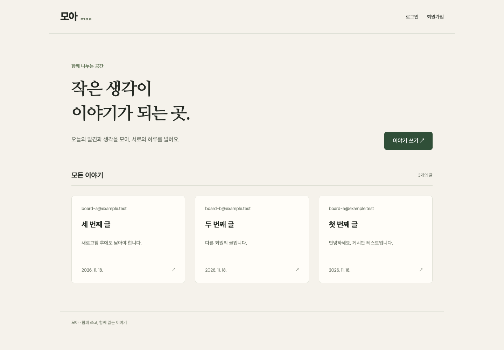
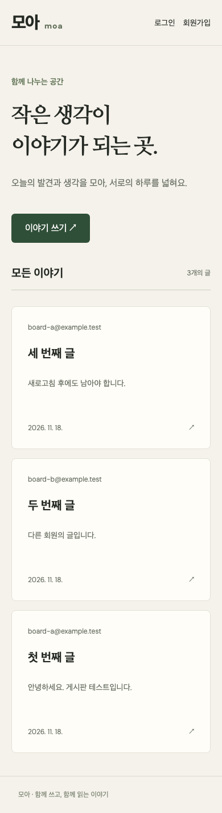
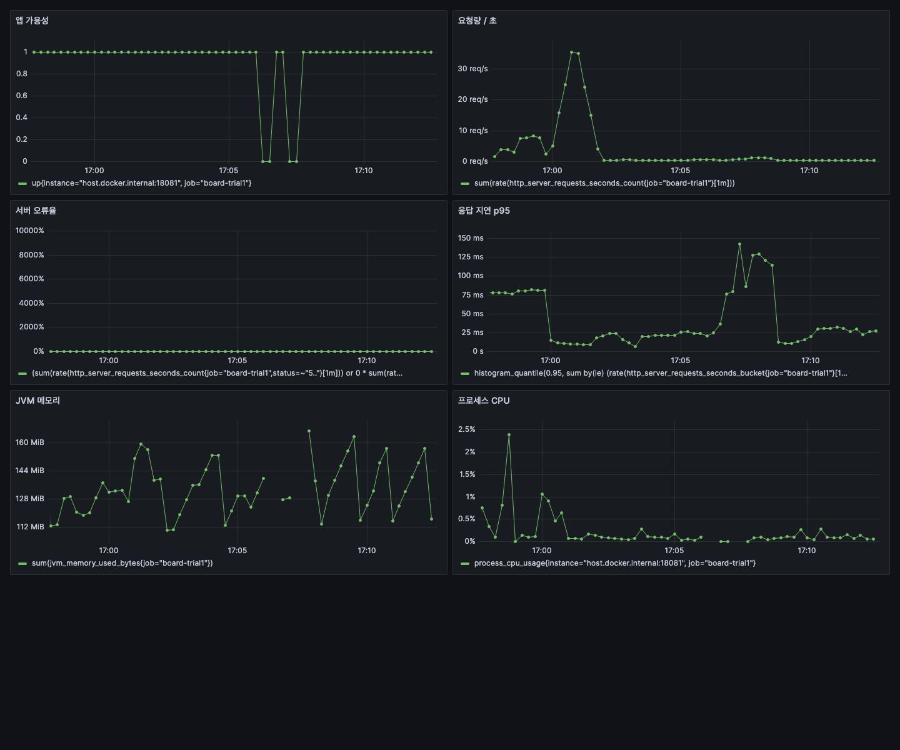

# [FEAT] 회원 게시판과 로컬 운영 검증 구성

## 📌 관련 이슈

이슈 게시 전입니다. 원 요청은 [테스트1 실험](https://app.notion.com/p/41b04552316d8092908fdff93c682973)이며 실행 기록은 [실험 할 일](https://app.notion.com/p/41c04552316d81a399e4f69be773fa9c)에 있습니다.

## 📝 작업 내용

빈 저장소에서 회원 인증과 게시판을 구현해 풀스택 개발·협업 워크플로우를 시험했습니다. 가입한 두 회원이 각자 글을 작성하고 누구나 읽을 수 있으며, 작성자만 수정·삭제합니다. DB 제약과 서버 권한 검사를 사용해 직접 API 요청에서도 중복·사칭·비회원 쓰기를 거절합니다.

동작을 재현할 수 있도록 단위·통합·24개 E2E 검사, OpenAPI, Prometheus·Grafana, k6, 장애·복구 검사와 한국어 실행·배포 문서를 함께 제공합니다.

## 🔍 변경 사항

- [x] 기능 추가
- [x] 버그 수정
- [x] 테스트 추가 / 수정
- [x] 문서 수정
- [x] 기타 — 로컬 부하·장애 시험 및 관측 증거

## 💡 구현 방법 / 주요 변경 포인트

서버 세션을 무효화해 로그아웃 자격 재사용을 막습니다. CSRF 검증은 변경 요청에 적용하고, 비밀번호 해시는 응답 DTO에 포함하지 않습니다. 게시글 작성자는 요청 세션에서 가져오며 UPDATE·DELETE의 DB 조건에도 author_id를 넣었습니다. 데이터는 PostgreSQL에 저장해 앱 재기동 이후에도 유지합니다.

## ✅ 테스트 방법

1. README의 Java 21·Node 22·PostgreSQL 환경과 앱·UI를 실행합니다.
2. `./gradlew :backend:check`, `npm run lint`, `npm run format:check`, `npm run build`, `npm run test:e2e`를 실행합니다.
3. 전용 시험 데이터의 정상·오류·권한·재기동 상태를 확인합니다. 로컬 운영 시험은 README의 승인 범위와 명령을 따릅니다.

로컬 E2E 24/24, k6 2340 요청·오류율 0%·p95 11.84ms, 장애 탐지 2361ms·복구 2236ms를 확인했습니다. 원시 근거는 evidence 디렉터리에 있습니다.

## 📸 스크린샷

## ⚠️ 리뷰어에게 전달 사항

작성자 권한, 세션 무효화, CSRF와 계약 오류 응답, 시나리오별 DB·세션 초기화, 앱 프로세스 소유권 확인을 중심으로 검토해 주세요. 배포 후 실제 URL 검증과 원격 CI는 미실행입니다. 개발용 의존성 감사 high 4건과 코드 품질 한계는 review.md에 있습니다.

에이전트의 전역 로그 조회 중 기존 서비스 토큰이 노출된 사건으로 전체 실험은 완전 성공으로 채택하지 않습니다. 값 자체는 이 PR 자료에 포함하지 않았으며 사용자 폐기·재발급과 독립 검토가 필요합니다. 이 문서는 사용자 승인 전 로컬 PR 초안입니다.

## 📋 셀프 체크리스트

- [x] 코드 컨벤션 검사 수행
- [x] 제출 파일의 불필요한 비밀값·로그 점검
- [x] 테스트 작성과 실행
- [x] PR 제목에 구현 결과 명시
- [ ] 사용자 PR 게시 승인
- [ ] 사용자 배포 후 실제 환경 검증
- [ ] 독립 리뷰와 최종 수용
